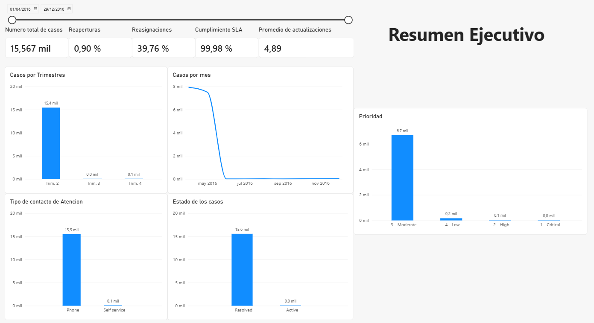
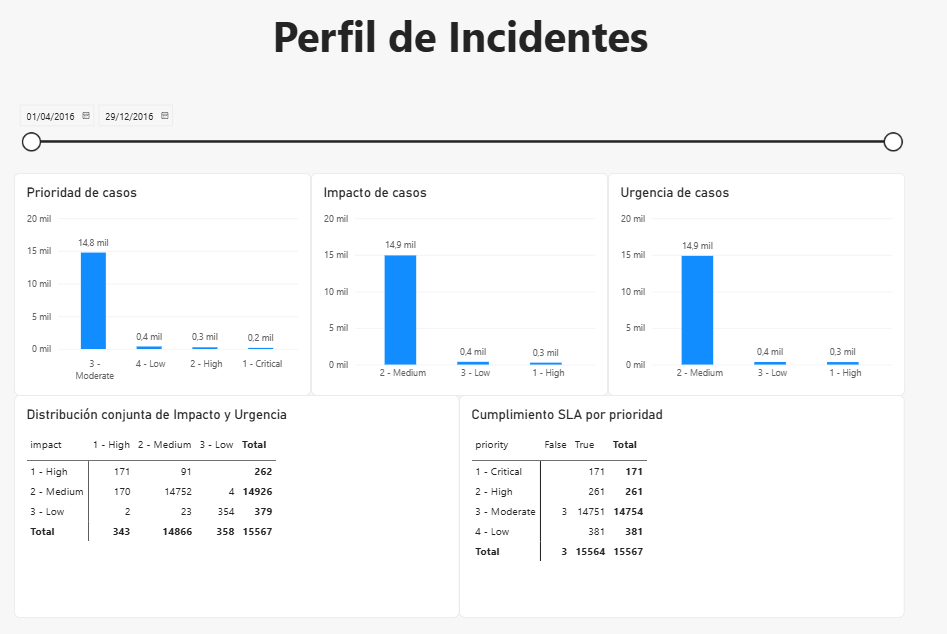
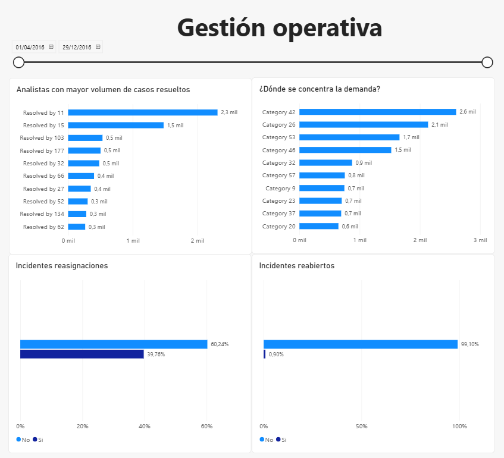

# ERP Support Operations Dashboard

## Vista Previa



## Descripción del Proyecto

Proyecto de análisis de datos y Business Intelligence enfocado en la gestión de incidentes de soporte ERP. El objetivo principal es evaluar el desempeño operativo, el cumplimiento de los acuerdos de nivel de servicio (SLA) y la eficiencia de los procesos de atención mediante técnicas de análisis exploratorio de datos (EDA) en Python y visualización interactiva en Power BI.

---

## Fuente de Datos

El dataset utilizado en este proyecto corresponde a:

**Incident Management Process Enriched Event Log**

Fuente oficial:

[\[Enlace a la fuente oficial\]](https://archive.ics.uci.edu/dataset/498/incident+management+process+enriched+event+log)

El conjunto de datos fue utilizado exclusivamente con fines educativos y de construcción de portafolio profesional

El conjunto de datos original fue almacenado en:

Data/
├── Raw/


---

## Objetivos

- Analizar el ciclo de vida de los incidentes.
- Evaluar el cumplimiento de los SLA.
- Identificar patrones de reapertura y reasignación.
- Analizar la distribución de impacto, urgencia y prioridad.
- Construir un dashboard ejecutivo para el seguimiento de indicadores operativos.

---

## Dataset

**Incident Management Process Enriched Event Log**

Características principales:

- 141.712 registros de eventos.
- 24.918 incidentes únicos.
- 36 variables originales.
- Ventana de análisis centrada en los trimestres completos de 2016 (Q2-Q4).

---

## Herramientas Utilizadas

### Análisis de Datos

- Python
- Pandas
- NumPy
- Matplotlib
- Seaborn

### Inteligencia de Negocio

- Power BI

### Documentación

- Jupyter Notebook
- Microsoft Excel

---

## Metodología

El proyecto fue desarrollado siguiendo las siguientes etapas:

1. Comprensión del negocio.
2. Comprensión y exploración del dataset.
3. Limpieza y transformación de datos mediante Python.
4. Análisis exploratorio de datos (EDA).
5. Identificación de hallazgos clave.
6. Construcción de dashboard interactivo en Power BI.

---

## Principales Hallazgos

### Reapertura de incidentes

Solo el 0,9 % de los incidentes requirió al menos una reapertura, lo que indica que este comportamiento fue poco frecuente dentro del proceso analizado.

### Reasignación de incidentes

Aproximadamente el 39,76 % de los incidentes fue reasignado al menos una vez, lo que evidencia que la transferencia de casos representa una parte relevante de la operación.

### Complejidad operativa

Cada incidente registró, en promedio, 5,9 actualizaciones durante su ciclo observado, lo que sugiere que la gestión de los casos requiere múltiples interacciones y cambios antes de alcanzar su resolución.

### Cumplimiento de SLA

El cumplimiento de los acuerdos de nivel de servicio fue elevado durante el periodo evaluado. Dependiendo del nivel de análisis utilizado (eventos o incidentes consolidados), el indicador presenta valores superiores al 95 %.

### Perfil de incidentes

La mayoría de los incidentes se concentró en niveles medios de impacto, urgencia y prioridad, lo que sugiere una carga operativa compuesta principalmente por requerimientos de complejidad moderada.

### Concentración temporal

La creación de nuevos incidentes se concentra de forma extraordinaria durante el segundo trimestre de 2016. Los incidentes creados durante el tercer y cuarto trimestre representan una proporción muy reducida del total analizado. Este comportamiento corresponde a la distribución observada en la fuente de datos original y condiciona la interpretación de las tendencias temporales.

---

## Dashboard Power BI

El dashboard fue diseñado en tres niveles de análisis:

### Página 1: Resumen Ejecutivo

- Total de incidentes.
- Cumplimiento SLA.
- Reaperturas.
- Reasignaciones.
- Complejidad operativa.
- Tendencias temporales.


### Página 2: Perfil de Incidentes

- Prioridad.
- Impacto.
- Urgencia.
- Relación impacto-urgencia.
- Cumplimiento SLA por prioridad.



### Página 3: Gestión Operativa

- Analistas con mayor volumen de casos resueltos.
- Categorías con mayor demanda.
- Reasignaciones.
- Reaperturas.



---

## Estructura del Proyecto

```text
ERP-Support-Operations-Dashboard
│
├── Data
│   ├── Raw
│   │   └── incident+management+process+enriched+event+log.zip   - Data set Original
│   │
│   └── Processed
│       ├── Diccionario de datos.xlsx                            - Diccionario de datos y comentarios del data set
│       ├── incident_powerbi.csv                                 - Archivo CSV creado con la depuracion de python para alimentar el power BI
│       └── incident_powerbi_single.csv                          - Archivo CSV creado con la depuracion de python para alimentar el power BI
│
├── Images
│   ├── dashboard_executive.png                                  - Imagen de la primera hoja de power bi, contiene el resumen ejecutivo
│   ├── dashboard_profile.png                                    - Imagen de la segunda hoja de power bi, contiene el perfil de incidentes
│   └── dashboard_operations.png                                 - Imagen de la tercera hoja de power bi, contiene el detalle de los casos
│
├── Notebooks
│   └── ERP_Incident_Analysis.ipynb                              - Notebook de Jupyter utilizado para la limpieza, transformación y análisis de datos.
│
├── Power BI
│   └── ERP_Support_Dashboard.pbix                               - Archivo Power BI que contiene el dashboard construido a partir del proceso de limpieza y análisis realizado en Python.
│
├── README.md
├── LICENSE
└── .gitignore
```

---

## Autor

Andrés Elías Arias Varón

Proyecto desarrollado como parte del portafolio profesional de Analítica de Datos y Business Intelligence.